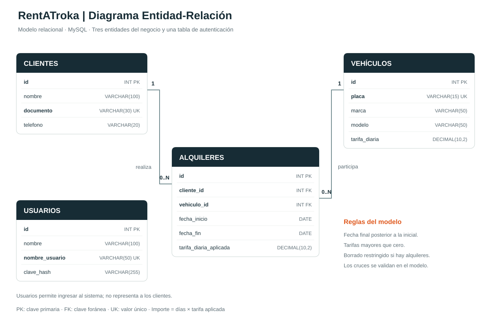
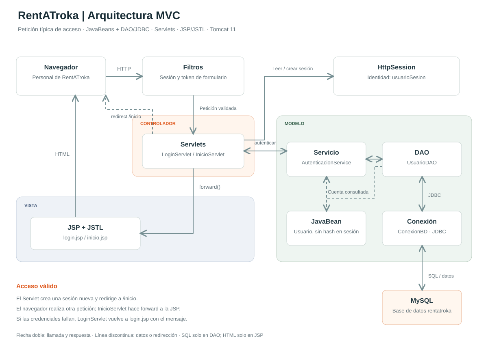

# Diseño y explicación de nuestra parte

## Problema y alcance

RentATroka organiza la información de clientes, vehículos y alquileres de una empresa. El registro de cada alquiler relaciona a una persona con un vehículo durante un periodo determinado y conserva la tarifa aplicada. El personal ingresa con una cuenta autenticada.

La base y el acceso ya están implementados. Los CRUD de las tres entidades principales, la búsqueda y la vista del JOIN se integrarán desde los módulos de los otros integrantes. Este documento es material de apoyo para consolidar después el informe final de 3-5 páginas, junto con capturas de las funciones terminadas.

## Diagrama Entidad-Relación

La fuente editable se encuentra en `diagramas/entidad-relacion.mmd`; también se entrega una versión PNG para insertar en el informe.

- **Cliente 1 a 0..N Alquileres:** un cliente puede no haber alquilado todavía o tener varios alquileres. Cada alquiler pertenece a un cliente.
- **Vehículo 1 a 0..N Alquileres:** un vehículo puede tener varios alquileres en periodos diferentes. Cada alquiler corresponde a un vehículo.
- Clientes y vehículos forman una relación muchos a muchos a lo largo del tiempo, resuelta mediante la entidad Alquiler, que tiene fechas y tarifa propias.
- **Usuario** sirve para autenticación y no representa al cliente. Se mantiene separado porque el personal es quien usa el sistema; no se necesita vincularlo al alquiler para el alcance acordado.
- Documento, placa y nombre de usuario son únicos. Las claves foráneas conservan la integridad entre las tres entidades del negocio.

Los datos son atómicos y cada entidad guarda sus propios atributos. Alquiler conserva referencias al cliente y al vehículo; no copia su nombre, teléfono, marca ni placa. `tarifa_diaria_aplicada` representa el precio pactado en ese alquiler y puede diferir de la tarifa actual del vehículo. El importe total se deriva de fechas y tarifa, evitando guardar un cálculo repetido.

## Diagrama de arquitectura MVC

La fuente editable se encuentra en `diagramas/arquitectura-mvc.mmd`; también se entrega en PNG.

El diagrama representa la base implementada usando el acceso como petición típica:

1. El navegador solicita una página o envía el formulario de acceso. Los filtros controlan la sesión y, para POST, el token de formulario.
2. `LoginServlet` recibe usuario y contraseña. Valida los campos de la petición y llama a `AutenticacionService`, sin escribir SQL ni HTML.
3. El servicio solicita la cuenta a `UsuarioDAO`. El DAO utiliza JDBC mediante `ConexionBD` y una consulta preparada a MySQL.
4. El DAO devuelve un JavaBean `Usuario`. El servicio comprueba el hash y retira ese hash de la identidad que devuelve al controlador.
5. Si las credenciales son correctas, el Servlet invalida la sesión anterior, crea una nueva `HttpSession` y guarda `usuarioSesion`.
6. El Servlet envía un redirect a `/inicio`. El navegador realiza otra petición; `InicioServlet` hace forward a `inicio.jsp`, que genera el HTML.
7. Si faltan datos o las credenciales no son válidas, se hace forward a `login.jsp` con un mensaje y se conserva únicamente el nombre de usuario.

El modelo incluye JavaBeans, DAO y el servicio con las reglas de acceso. Los controladores coordinan HTTP; las JSP presentan datos mediante JSTL. La base MySQL es la persistencia. Los filtros y `HttpSession` son elementos transversales del acceso, no una cuarta capa del MVC.

## Explicación breve para la defensa

Podemos iniciar mostrando el ER y explicar que Alquiler resuelve la relación entre clientes y vehículos. Después, demostrar el rechazo de una contraseña incorrecta, ingresar correctamente y cerrar sesión. Al intentar volver al inicio, el sistema debe pedir acceso otra vez.

Para explicar el código, recorrer `LoginServlet → AutenticacionService → UsuarioDAO → ConexionBD → MySQL`, y luego `HttpSession → InicioServlet → inicio.jsp`. Destacar que el Servlet no contiene SQL ni HTML, que el DAO cierra sus recursos y que la vista no consulta la base.

Las capturas definitivas deben tomarse después de integrar los CRUD. En la defensa de 10-15 minutos, los cuatro integrantes necesitan demostrar y comprender sus módulos, además de conocer el funcionamiento general del MVC.

