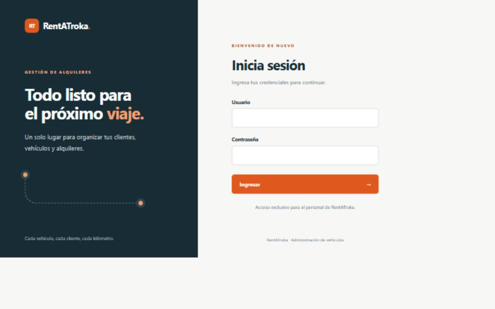
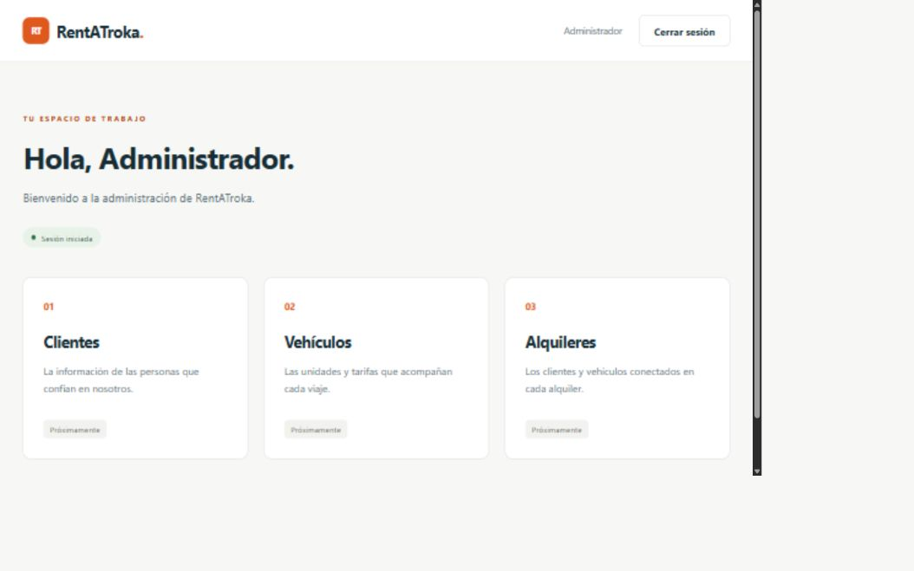

# Verificación de nuestra parte

Comprobaciones realizadas el 15 de octubre de 2026 en el equipo local, con JDK 27 compilando para Java 17, Tomcat 11.0.26 y MySQL 8.4 en Docker.

## Compilación y pruebas Java

`mvn clean verify` finalizó correctamente y generó `target/RentATroka.war`. Pasaron **14 pruebas automatizadas**, sin errores ni omisiones: verificación de la cuenta semilla, rechazo de contraseñas incorrectas y hashes dañados, sal individual, caracteres especiales, validación previa a la consulta, retiro del hash de la identidad y propagación de fallos de conexión. Después del ajuste visual para móvil se volvió a empaquetar el WAR y se desplegó nuevamente.

## Tomcat y MySQL reales

Se completaron **20 comprobaciones HTTP** del acceso, incluyendo protección de `/inicio`, formulario público, cookies HttpOnly/SameSite, rechazo de formularios sin token, validaciones del servidor, intento de inyección SQL, escape de HTML, login correcto, renovación del ID de sesión, identidad en pantalla, ausencia de caché, bloqueo de acceso directo a JSP y cierre de sesión.

Como comprobación adicional, se detuvo la instancia de MySQL del proyecto: el login respondió con estado 503 y un mensaje comprensible, sin mostrar detalles internos. Después se restableció MySQL y se confirmó su estado saludable.

Se importaron ambos scripts de nuevo sin duplicar los datos: **1 usuario, 3 clientes, 3 vehículos y 2 alquileres**. Se verificaron nombres con acentos y el JOIN, con importes de **195.00** y **240.00** para los dos alquileres semilla. MySQL rechazó una placa repetida, una tarifa negativa, fechas invertidas, un cliente inexistente y el borrado de un cliente relacionado. Las pruebas de rechazo usaron transacciones sin conservar cambios.

## Revisión visual

Se revisaron el acceso y el inicio en el navegador, el diseño de ancho reducido sin desbordamiento horizontal y la legibilidad de los diagramas ER y MVC. Las capturas de esta etapa se encuentran en `capturas/`.

Los CRUD todavía no están implementados; esta verificación cubre nuestra base y autenticación. La disponibilidad de vehículos y el JOIN mostrado en una JSP deben verificarse al integrar el módulo de alquileres. La defensa, la rúbrica impresa y la publicación en GitHub siguen siendo tareas de la entrega final.

